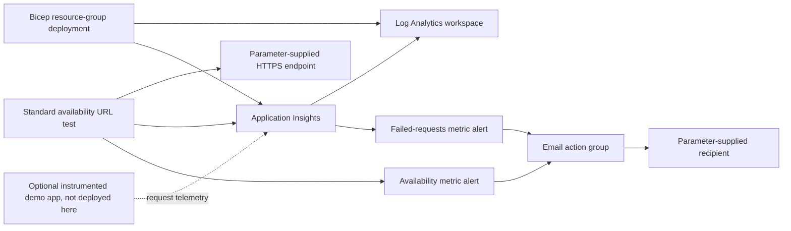

# Azure Monitor Bicep Baseline

Matthew Coggins | SRE monitoring portfolio lab | MIT

A small Bicep template for an Azure Monitor lab in one resource group. It creates a Log Analytics workspace, workspace-based Application Insights, a standard availability test, an email action group, and two metric alerts.

This is a portfolio sample. It has not been deployed to Azure, and it is not a record of work done for an employer. GitHub Actions compiles the file and runs a structural linter. That check does not deploy anything, and it does not show that probes run, alerts fire, email arrives, or cleanup works.

## Architecture



## What each resource does

| Resource | What it does |
| --- | --- |
| Log Analytics workspace | Pay-as-you-go workspace (`PerGB2018`), 30-day retention, and a 1 GB daily ingestion cap. The cap is an ingestion quota. It does not limit web-test, alert, or other subscription charges. |
| Workspace-based Application Insights | `WorkspaceResourceId` points at the workspace. Using `workspace.id` makes Bicep deploy the workspace first. |
| Standard availability web test | HTTPS GET every five minutes from `us-va-ash-azr`, `us-ca-sjc-azr`, and `emea-nl-ams-azr`, with retries enabled, HTTP 200 required, and a TLS certificate check of seven days of remaining life. The test kind is `standard`. |
| Email action group | The recipient comes from a parameter, the common alert schema is on, and both alerts use this same group. |
| Availability metric alert | Web-test criteria, severity 2, at least two failing locations, a five-minute window, and evaluation every minute. |
| Failed-requests metric alert | Application Insights `requests/failed`, `Count` aggregation, greater than five in five minutes, severity 2, and evaluation every minute. |

Both alerts are enabled, and Azure resolves them on its own when the condition clears. The failed-requests rule has nothing to count until a separate application sends request telemetry to this Application Insights resource. The web test only calls a URL. It does not install an SDK, and it does not prove that the failed-requests rule fires. No application, host, or SDK is deployed here.

## Deploy it yourself

Azure needs extra time to finish provisioning and to ingest telemetry. You need the Azure CLI with Bicep, a subscription, permission to deploy into a resource group, and the `Microsoft.Insights` and `Microsoft.OperationalInsights` providers registered. Deploy only if you accept the possible charges. This repository does not run the commands below.

1. Clone the repo and sign in. Check the account table and stop if it is not the lab subscription.

```bash
git clone https://github.com/yellowlotuscg/azure-monitor-bicep-baseline.git
cd azure-monitor-bicep-baseline
az login
az account show --output table
az bicep install
```

2. Copy the example parameters to a local file that git ignores. The committed file uses `https://example.com/` and `alerts@example.com` as placeholders. Put in a public HTTPS endpoint you own or are allowed to test, and put in your own recipient. Do not commit real addresses or subscription IDs. `alertEmail` is a secure Bicep parameter. The action group still stores the address in Azure. `namePrefix` must be 3 to 24 characters, start with a letter, and use only lowercase letters, numbers, and hyphens.

```bash
cp main.parameters.json demo.local.parameters.json
```

3. Use a new resource group that holds only this lab. The workspace, Application Insights, and the web test use the group's region unless you set `location`. The action group and both alert rules are global. Read the change list before you create anything.

```bash
az group create --name rg-monitor-portfolio-lab --location eastus
az bicep build --file main.bicep
az deployment group validate \
  --resource-group rg-monitor-portfolio-lab \
  --template-file main.bicep --parameters @demo.local.parameters.json
az deployment group what-if \
  --resource-group rg-monitor-portfolio-lab \
  --template-file main.bicep --parameters @demo.local.parameters.json
az deployment group create \
  --name monitor-portfolio-lab \
  --resource-group rg-monitor-portfolio-lab \
  --template-file main.bicep --parameters @demo.local.parameters.json
```

`az bicep build` writes `main.json` beside the template. That file is gitignored. The deployment outputs are resource IDs only: no connection strings and no recipient. Region support, probe-location availability, provider registration, and subscription policy are things you have to check in your own subscription.

4. In the Azure portal, open the resource group, then Application Insights > Availability, for probe results. Open Azure Monitor > Alerts > Alert rules and filter to the lab resource group for both rules. Azure Monitor > Alerts > Action groups shows the email receiver. The test action on that group sends a real message. If you are allowed to, make only your own demo endpoint fail so you can see the availability rule, then restore the endpoint. Instrument a separate demo app and generate failed requests to exercise the other rule. Wait for ingestion and evaluation, then look at fired and resolved alerts. No alert delivery has been verified for this repository.

## Delete the lab

Deleting the deployment record removes deployment history only. The resources stay, and charges can continue:

```bash
az deployment group delete \
  --resource-group rg-monitor-portfolio-lab \
  --name monitor-portfolio-lab
```

To remove the lab, confirm the dedicated group contains nothing unrelated, then delete the group. That deletes everything in the group. Keep the confirmation prompt:

```bash
az group delete --name rg-monitor-portfolio-lab
az group exists --name rg-monitor-portfolio-lab
```

The last command should print `false` after deletion finishes. Save any redacted evidence first. Do not delete a shared resource group.

## Cost

Some monitoring configuration is free to create, and a short, quiet lab can stay small. This is not a free tier. The standard availability test runs every five minutes from three locations, and each execution is billed while the test stays enabled. Left running, that becomes a recurring charge. Log ingestion, retention past the included allowance, metric alert rules, and notifications can also cost money, depending on current allowances and the region. The 1 GB workspace cap does not cap web-test, alert, or total subscription spend. Read [Azure Monitor pricing](https://azure.microsoft.com/pricing/details/monitor/), set a budget, and delete the lab resource group when you are done looking.

## Checks

GitHub Actions installs Bicep CLI `v0.48.1` and runs two commands. Neither one logs in to Azure or deploys:

```bash
python3 scripts/lint_bicep.py --self-test
bicep build main.bicep
```

`az bicep build` on your machine calls the same compiler through the Azure CLI. `az deployment group validate` still needs your subscription, and CI does not run it.

The Python script uses the standard library only. It checks balanced braces, brackets, and parentheses outside comments and strings; six resources with a type, API version, and name; declared symbols and the simple interpolations used here; required example parameters; two alert actions; the workspace link; and an em dash anywhere in the repo. Five negative fixtures must be rejected. It is a narrow checker for this template, not a Bicep parser, a type checker, or an Azure schema validator.

On Bicep CLI 0.48.1, `bicep build` succeeds and prints one warning, BCP035, on the failed-requests criteria object. The warning says `criterionType` is required, and it also says the type definition may be wrong. The compiled template still uses the `odata.type` shape for API version `2018-03-01`. The resource was left as written.

A manual read should still cover dependencies, which resources are global and which follow `location`, metric namespace, name, and aggregation, the web test's hidden-link tag to Application Insights, and the alert scopes. These API versions are pinned on purpose: workspace `2023-09-01`, Application Insights `2020-02-02`, web test `2022-06-15`, action group `2023-01-01`, metric alerts `2018-03-01`. Newer versions exist. This lab does not use their extra features.

CI compilation does not show that a deployment succeeds, that data is ingested, that probes run, that alerts fire, that email is delivered, or that cleanup works. None of that has been run from this repository.

References:

- [Workspace schema](https://learn.microsoft.com/azure/templates/microsoft.operationalinsights/2023-09-01/workspaces)
- [Application Insights schema](https://learn.microsoft.com/azure/templates/microsoft.insights/2020-02-02/components)
- [Standard web test schema](https://learn.microsoft.com/azure/templates/microsoft.insights/2022-06-15/webtests)
- [Action group schema](https://learn.microsoft.com/azure/templates/microsoft.insights/2023-01-01/actiongroups)
- [Metric alert schema](https://learn.microsoft.com/azure/templates/microsoft.insights/2018-03-01/metricalerts)
- [Application Insights supported metrics](https://learn.microsoft.com/azure/azure-monitor/reference/supported-metrics/microsoft-insights-components-metrics)

## Screenshots

There are no screenshots. The lab has not been deployed, so there is no real evidence to show. Do not add a mock image in place of a deployment.

After your own deployment, you can add redacted pictures of:

- The resource group with the six resources.
- Application Insights Availability with probe results.
- Both alert rules and their criteria.
- A fired alert and the resolved alert, with private details removed.
- Confirmation that the resource group was deleted.

Remove subscription IDs, tenant IDs, real recipient addresses, endpoint secrets, and other private identifiers before you publish them.
