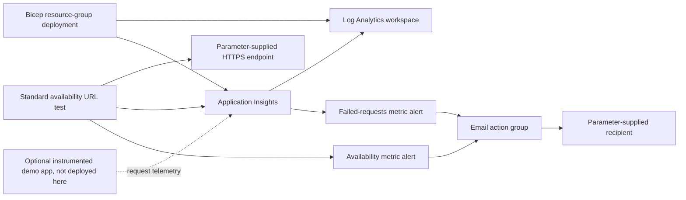

# Azure Monitor Bicep Baseline

Matthew Coggins | SRE monitoring portfolio lab | MIT

Small, resource-group-scoped Bicep demo templates for Azure Monitor. This is a portfolio lab, not a production deployment or evidence of work performed at any company. These templates have not been deployed to Azure. Structural checks are not compilation or deployment proof.

## Architecture



## What each resource demonstrates

| Resource | Portfolio skill demonstrated |
| --- | --- |
| Log Analytics workspace | Pay-as-you-go workspace provisioning, 30-day retention and a 1 GB daily ingestion cap. The cap is not a guaranteed billing ceiling. |
| Workspace-based Application Insights | Explicit workspace association through resource IDs and implicit Bicep dependencies. |
| Standard availability web test | HTTPS GET every five minutes from three locations, retries, HTTP 200 validation and certificate expiry checking (seven days). Uses Standard tests, not legacy URL ping tests. |
| Email action group | Parameterized recipient, common alert schema, shared notification routing. |
| Availability metric alert | Dedicated web-test criteria, at least two failing locations, severity 2, five-minute window and one-minute evaluation. |
| Failed-requests metric alert | Application Insights `requests/failed`, Count aggregation greater than five over five minutes, severity 2 and one-minute evaluation. |

Both alerts are enabled and auto-mitigating. The failed-requests rule needs a separately instrumented application sending request telemetry to this Application Insights resource. The web test alone does not instrument your application or prove that this rule fires. No application, hosting service or SDK is deployed here.

## Five-minute quickstart

Allow additional time for provisioning and telemetry. Requires Azure CLI with Bicep support, an Azure subscription, appropriate resource-group deployment permissions, and registered `Microsoft.Insights` and `Microsoft.OperationalInsights` providers. Only deploy if you approve the potential charges. This repository does not run these commands automatically.

1. Clone and sign in. Select your intended lab subscription interactively, then verify it before proceeding.

```bash
git clone git@github.com:yellowlotuscg/azure-monitor-bicep-baseline.git
cd azure-monitor-bicep-baseline
az login
az account show --output table
az bicep install
```

2. Copy the fake example parameters to an ignored local file. Replace `https://example.com/` with a public HTTPS endpoint you own or have permission to test, and `alerts@example.com` with your recipient locally. Never commit real addresses or subscription identifiers. `alertEmail` is a secure Bicep parameter, but the action group necessarily stores the recipient in Azure. Keep `namePrefix` lowercase alphanumeric/hyphen, starting with a letter.

```bash
cp main.parameters.json demo.local.parameters.json
```

3. Use a new, dedicated resource group in a supported region. Review changes and validate before deploying.

```bash
az group create --name rg-monitor-portfolio-lab --location eastus
az bicep build --file main.bicep
az deployment group validate \
  --resource-group rg-monitor-portfolio-lab \
  --template-file main.bicep --parameters @demo.local.parameters.json
az deployment group what-if \
  --resource-group rg-monitor-portfolio-lab \
  --template-file main.bicep --parameters @demo.local.parameters.json
az deployment group create \
  --name monitor-portfolio-lab \
  --resource-group rg-monitor-portfolio-lab \
  --template-file main.bicep --parameters @demo.local.parameters.json
```

Outputs contain resource IDs only, not connection strings or recipients. Region support, probe-location availability, provider registration and subscription policies must be checked in your Azure environment.

4. In the Azure portal, open the resource group, then Application Insights > Availability for probe results. Open Azure Monitor > Alerts > Alert rules and filter to the lab resource group to find both rules. Azure Monitor > Alerts > Action groups shows the email receiver and its test action. Testing the action group sends a real message. With permission, make only your own demo endpoint fail to exercise the availability rule, then restore it. Separately instrument a demo app and generate failed requests to exercise the other rule. Wait for ingestion and evaluation, then inspect fired and resolved alerts. No alert delivery has been verified for this repository.

## Cleanup, do not skip

Deleting the deployment record only removes deployment history. It does NOT remove resources or stop charges:

```bash
az deployment group delete \
  --resource-group rg-monitor-portfolio-lab \
  --name monitor-portfolio-lab
```

To actually remove the lab, confirm that this dedicated group contains no unrelated resources, then delete it. This is destructive and removes the entire group's contents. Keep the interactive confirmation:

```bash
az group delete --name rg-monitor-portfolio-lab
az group exists --name rg-monitor-portfolio-lab
```

The final command should return `false` after deletion completes. Save redacted evidence first. Do not delete a shared resource group.

## Cost note

Many individual monitoring configuration resources are free, and a short, low-volume lab may cost pennies, but this is not a free-tier guarantee. Standard availability tests are billed per execution across probe locations and can accumulate meaningful recurring charges if left running. Log ingestion, retention beyond included allowances, metric alert rules and notifications can also incur charges depending on current allowances and region. A workspace ingestion cap does not cap web-test, alert or total subscription spend. Review [Azure Monitor pricing](https://azure.microsoft.com/pricing/details/monitor/), set a budget, and delete the dedicated lab resource group promptly after collecting evidence.

## Validation and limits

```bash
python3 scripts/lint_bicep.py --self-test
```

The standard-library-only script checks balanced braces/brackets/parentheses outside comments and strings, six resource declarations with type/API version and names, declared symbols and simple interpolations, required example parameters, two alert actions, workspace linkage and forbidden punctuation. Negative fixtures check basic rejection behavior. It is deliberately a narrow structural linter for this template, not a general Bicep parser, type checker or Azure schema validator. It does not validate string-interpolation syntax beyond the simple expressions used here.

Manual structural review checks resource dependencies, global versus regional locations, metric namespace/name and aggregation, test/component linkage and alert scopes. Stable API versions are pinned intentionally: workspace `2023-09-01`, Application Insights `2020-02-02`, web test `2022-06-15`, action group `2023-01-01`, metric alerts `2018-03-01`. Newer API versions may exist; this lab does not require their features.

No Azure CLI or local Bicep compiler was available on the authoring Mac. Full compilation and deployment validation still require Azure CLI/Bicep and an Azure subscription. No claim is made that deployment, ingestion, probe execution, alert firing, email delivery or cleanup has been exercised.

References:
- [Workspace schema](https://learn.microsoft.com/azure/templates/microsoft.operationalinsights/2023-09-01/workspaces)
- [Application Insights schema](https://learn.microsoft.com/azure/templates/microsoft.insights/2020-02-02/components)
- [Standard web test schema](https://learn.microsoft.com/azure/templates/microsoft.insights/2022-06-15/webtests)
- [Action group schema](https://learn.microsoft.com/azure/templates/microsoft.insights/2023-01-01/actiongroups)
- [Metric alert schema](https://learn.microsoft.com/azure/templates/microsoft.insights/2018-03-01/metricalerts)
- [Application Insights supported metrics](https://learn.microsoft.com/azure/azure-monitor/reference/supported-metrics/microsoft-insights-components-metrics)

## Screenshots, placeholders only

No screenshots are included because the lab has not been deployed. After your own authorized deployment, add redacted evidence of:

- Resource group showing the six deployed resources.
- Application Insights Availability showing probe results.
- Both alert rules and their criteria.
- A fired and resolved lab alert, with private details removed.
- Resource group deletion confirmation.

Remove subscription/tenant IDs, real recipient addresses, endpoint secrets and other private identifiers before publishing. Do not substitute mock screenshots for deployment evidence.
